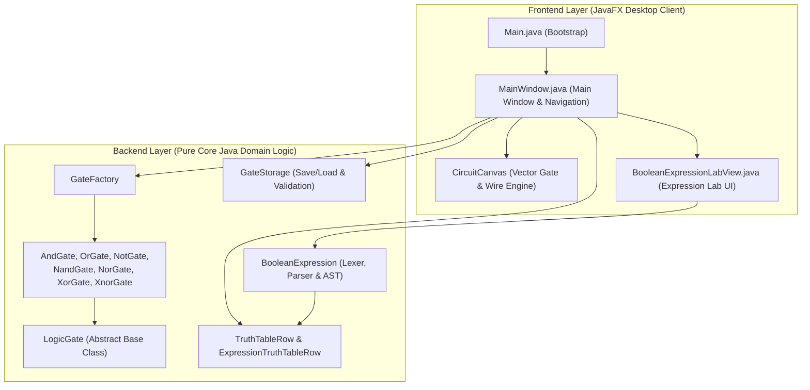

# Logic Gate Simulator & Boolean Expression Lab
### Digital Logic Laboratory — Java 21 & JavaFX Desktop Application

---

## Table of Contents

- [1. Overview & Key Features](#1-overview--key-features)
- [2. Technology Stack](#2-technology-stack)
- [3. Project Structure](#3-project-structure)
- [4. System Architecture](#4-system-architecture)
- [5. Feature 1: Individual Gate Simulator](#5-feature-1-individual-gate-simulator)
- [6. Feature 2: Boolean Expression Lab](#6-feature-2-boolean-expression-lab)
- [7. Object-Oriented Programming (OOP) Deep Dive](#7-object-oriented-programming-oop-deep-dive)
- [8. File Persistence & Defensive Validation](#8-file-persistence--defensive-validation)
- [9. Quick Start & Execution Guide](#9-quick-start--execution-guide)
- [10. Automated Verification & Test Suite](#10-automated-verification--test-suite)
- [11. License](#11-license)

---

## 1. Overview & Key Features

The **Logic Gate Simulator** bridges theoretical digital electronics and software engineering through two dedicated workspaces:

### Workspace 1: Individual Gate Simulator
* **All 7 Primary Digital Gates:** Simulates **AND**, **OR**, **NOT**, **NAND**, **NOR**, **XOR**, and **XNOR** gates.
* **Interactive Circuit Canvas:** Real-time 2D vector schematic rendering with IEEE standard gate symbols.
* **Live Logic Wires & LEDs:** Color-coded wiring that dynamically glows emerald green (`HIGH / 1`) or muted slate (`LOW / 0`) with radial gradient LED indicator lamps.
* **Synchronized Truth Tables:** Automatically calculates all $2^n$ combinations and highlights the row corresponding to the active switch states.
* **File State Persistence:** Save and reload complete simulation configurations to/from disk with defensive validation.

### Workspace 2: Boolean Expression Lab
* **Arbitrary Formula Evaluation:** Evaluates expressions containing variables **A**, **B**, and **C** using 7 operator keywords (`AND`, `OR`, `NOT`, `NAND`, `NOR`, `XOR`, `XNOR`) with parentheses grouping.
* **Automated Syntax Validation:** Pinpoints exact character offsets for syntax errors (missing operands, unclosed parentheses, unrecognized symbols) with helpful error messages.
* **Dynamic $2^n$ Truth Table Generator:** Automatically discovers distinct variables ($n \le 3$) and constructs interactive 2-, 4-, or 8-row truth tables.
* **Interactive Table-to-Switch Linking:** Clicking any row in the truth table immediately sets the input switches and re-evaluates the circuit.
* **Pedagogical Reduction Trace:** Displays a human-readable, step-by-step breakdown of intermediate logic operations.
* **Curated Examples Library:** Includes a 1-click preset library for standard curriculum formulas (e.g. `(A AND B) OR C`, `(A OR B) AND (NOT C)`, `NOT (A XOR B)`).

---

## 2. Technology Stack

| Layer | Technology | Details |
|:---|:---|:---|
| **Language** | Java 21 LTS | Pattern matching, enhanced switch expressions, records/DTOs |
| **User Interface** | JavaFX 21 | High-DPI canvas graphics, reactive properties, dark modern styling |
| **Build & Dependency**| Apache Maven 3.9+ | Standard compilation, resource management, and JavaFX plugin |
| **State Persistence** | Java NIO & I/O | `Files`, `Paths`, `BufferedReader`, `BufferedWriter` |
| **Quality Assurance** | Headless Test Engine | Standalone verification suite with 179 automated test assertions |
| **Operating System** | Cross-Platform | Windows 10/11, macOS, Linux |

---

## 3. Project Structure

```text
LogicGateSimulatorJava/
├── pom.xml                               # Maven build configuration & JavaFX dependencies
├── README.md                             # Technical documentation & user manual
├── .gitignore                            # Git exclusion rules
├── build.bat                             # 1-click Windows build script
├── run.bat                               # 1-click Windows launch script
├── saved_state.txt                       # Persisted gate simulator state file
│
├── backend/                              # Pure Java Domain Logic (Zero UI Dependencies)
│   ├── GateType.java                     # Type-safe enum for all 7 standard logic gates
│   ├── LogicGate.java                    # Abstract base class defining OOP contract
│   ├── AndGate.java                      # Concrete gate: AND logic (a && b)
│   ├── OrGate.java                       # Concrete gate: OR logic (a || b)
│   ├── NotGate.java                      # Concrete gate: NOT logic (!a)
│   ├── NandGate.java                     # Concrete gate: NAND logic (!(a && b))
│   ├── NorGate.java                      # Concrete gate: NOR logic (!(a || b))
│   ├── XorGate.java                      # Concrete gate: XOR logic (a != b)
│   ├── XnorGate.java                     # Concrete gate: XNOR logic (a == b)
│   ├── TruthTableRow.java                # Immutable row model for single-gate truth tables
│   ├── GateFactory.java                  # Factory pattern for polymorphic gate instantiation
│   ├── GateStorage.java                  # State persistence with defensive file validation
│   ├── BooleanExpression.java            # Lexer, recursive-descent parser, AST & evaluation engine
│   ├── ExpressionTruthTableRow.java      # Multi-variable truth table row model
│   ├── ExpressionParseException.java     # Checked exception with exact syntax error position
│   └── BackendTest.java                  # Standalone verification test suite (179 automated tests)
│
└── frontend/                             # JavaFX Graphical User Interface
    ├── Main.java                         # Application entry point & JavaFX bootstrap launcher
    ├── MainWindow.java                   # Main desktop window, canvas renderer, switches & controls
    └── BooleanExpressionLabView.java     # Boolean Expression Lab UI, preset carousel & trace view
```

---

## 4. System Architecture

The application enforces strict **Separation of Concerns (SoC)**:



### Architectural Highlights:
1. **Zero UI Coupling in Backend:** The `backend` package contains no imports from `javafx.*`, `java.awt.*`, or `javax.swing.*`. It runs headlessly in CI/CD pipelines, command lines, or embedded systems.
2. **Dynamic Binding:** Base classes define generic algorithmic contracts (e.g., `generateTruthTable()`) that automatically delegate to subclass logic via runtime polymorphism.
3. **Immutability & Safety:** Data transfer objects (`TruthTableRow`, `ExpressionTruthTableRow`, `SimulatorState`) use `private final` fields, guaranteeing state integrity across threads and event cycles.

---

## 5. Feature 1: Individual Gate Simulator

The Individual Gate Simulator allows students and engineers to test fundamental logic components with real-time feedback:

| Gate | Algebraic Expression | Description | Truth Table Summary |
|:---:|:---:|:---|:---:|
| **AND** | $Y = A \cdot B$ | Output is `1` only when both inputs are `1`. | `00->0, 01->0, 10->0, 11->1` |
| **OR** | $Y = A + B$ | Output is `1` when at least one input is `1`. | `00->0, 01->1, 10->1, 11->1` |
| **NOT** | $Y = \neg A$ | Inverts the input (Output is opposite of input). | `0->1, 1->0` |
| **NAND**| $Y = \neg(A \cdot B)$ | Output is `0` only when both inputs are `1` (Inverted AND). | `00->1, 01->1, 10->1, 11->0` |
| **NOR** | $Y = \neg(A + B)$ | Output is `1` only when both inputs are `0` (Inverted OR). | `00->1, 01->0, 10->0, 11->0` |
| **XOR** | $Y = A \oplus B$ | Output is `1` when inputs are different (Odd parity). | `00->0, 01->1, 10->1, 11->0` |
| **XNOR**| $Y = \neg(A \oplus B)$ | Output is `1` when inputs are identical (Equivalence). | `00->1, 01->0, 10->0, 11->1` |

### Interactive Features:
- **Glowing Vector Wires:** Real-time pathing connects input toggle switches directly to gate terminals and the output LED. Wires automatically glow green (`#22C55E`) for HIGH (1) and dark slate (`#475569`) for LOW (0).
- **Single-Input Adaptability:** When the NOT gate is selected, Input B is smoothly disabled and hidden, and the truth table dynamically adjusts to a 2-row layout.
- **Active Truth-Table Row Tracking:** Toggling switches immediately highlights the matching row in the truth table with a glowing indicator.

---

## 6. Feature 2: Boolean Expression Lab

The Boolean Expression Lab evaluates complex digital logic formulas over variables `A`, `B`, and `C`.

### 6.1 Supported Syntax & Operators

Operator keywords are strictly **case-insensitive** (e.g. `and`, `AND`, `AnD` are all valid):

| Operator | Keyword | Boolean Logic | Algebraic Symbol | Precedence Level |
|:---:|:---:|:---:|:---:|:---:|
| **Parentheses** | `( ... )` | Precedence override | `( ... )` | Level 1 (Highest) |
| **NOT** | `NOT` | $\neg A$ | `¬A` | Level 2 (Unary Prefix) |
| **AND** | `AND` | $A \land B$ | `A · B` | Level 3 (Multiplicative) |
| **NAND** | `NAND` | $\neg(A \land B)$ | `A ⊼ B` | Level 3 (Multiplicative) |
| **XOR** | `XOR` | $A \oplus B$ | `A ⊕ B` | Level 4 (Exclusive) |
| **XNOR** | `XNOR` | $\neg(A \oplus B)$ | `A ⊙ B` | Level 4 (Exclusive) |
| **OR** | `OR` | $A \lor B$ | `A + B` | Level 5 (Additive) |
| **NOR** | `NOR` | $\neg(A \lor B)$ | `A ⊽ B` | Level 5 (Additive) |

### 6.2 Precedence Rules in Action

Without parentheses, expressions strictly follow Boolean operator precedence:
- `A OR B AND C` $\implies$ evaluated as `A OR (B AND C)`
- `NOT A AND B` $\implies$ evaluated as `(NOT A) AND B`
- `(A OR B) AND C` $\implies$ parentheses override precedence, evaluating `(A OR B)` first
- `A XOR B AND C` $\implies$ evaluated as `A XOR (B AND C)`
- `A XOR B XOR C` $\implies$ evaluated left-to-right as `(A XOR B) XOR C`

### 6.3 Evaluation Pipeline

```text
[Raw Expression String]
          │
          ▼
    [Tokenizer / Lexer]   ──► Emits typed Tokens (VARIABLE, OPERATOR, LPAREN, RPAREN, EOF)
          │                   Tracks exact 0-indexed character positions for error reporting
          ▼
[Recursive-Descent Parser] ──► Validates grammar & operator precedence levels
          │                   Rejects unknown tokens, unbalanced parentheses, missing operands
          ▼
 [Abstract Syntax Tree]
          ├── VariableNode    ── Evaluates against input environment Map<String, Boolean>
          ├── NotNode         ── Inverts child result & logs intermediate step
          └── BinaryOpNode    ── Evaluates left/right sub-trees & applies Boolean operator
          │
          ├──► evaluate(Map<String, Boolean> inputs)
          ├──► generateTruthTable()  ──► Dynamically sizes 2^n table (2, 4, or 8 rows)
          ├──► toMathematicalString() ──► Renders algebraic notation (e.g. Y = (A · B) + C)
          └──► getEvaluationSteps()   ──► Outputs step-by-step reduction trace
```

### 6.4 Pedagogical Step Trace Example

For the expression `(A AND B) OR C` with inputs `A = 1, B = 0, C = 1`:
```text
Step 1: A = 1
Step 2: B = 0
Step 3: C = 1
Step 4: (A AND B) = 1 AND 0 = 0
Step 5: (A AND B) OR C = 0 OR 1 = 1
```

---

## 7. Object-Oriented Programming (OOP) Deep Dive

This codebase is structured as a reference implementation of Core Java OOP principles:

| OOP Pillar | Code Implementation | Purpose & Benefit |
|:---|:---|:---|
| **1. Abstraction** | [`abstract class LogicGate`](file:///d:/Gate%20Simulator/LogicGateSimulatorJava/backend/LogicGate.java) | Declares the public contract (`evaluate(a, b)`, `generateTruthTable()`) while hiding internal gate logic. |
| **2. Encapsulation** | `protected GateType type`, `private final boolean inputA` | Restricts direct access to internal variables; access is granted only through public getters (`getName()`, `getExpression()`). |
| **3. Inheritance** | `class AndGate extends LogicGate` | Child classes inherit common fields, metadata accessors, and table generation from `LogicGate` using `super(...)`. |
| **4. Polymorphism (Overriding)** | `@Override public boolean evaluate(...)` | Each subclass provides its own boolean logic. Calling `gate.evaluate()` executes the specific gate's logic at runtime. |
| **5. Polymorphism (Overloading)**| `evaluate(boolean a)` vs `evaluate(boolean a, boolean b)` | Method overloading provides a convenient single-parameter invocation for 1-input gates like NOT. |
| **6. Dynamic Binding** | `LogicGate.generateTruthTable()` | Base class invokes `this.evaluate(...)` which dynamically dispatches to the derived subclass instance. |
| **7. Factory Pattern** | [`GateFactory.createGate(GateType)`](file:///d:/Gate%20Simulator/LogicGateSimulatorJava/backend/GateFactory.java) | Decouples GUI controls from concrete constructors using modern switch expressions. |
| **8. Type-Safe Enums** | [`GateType`](file:///d:/Gate%20Simulator/LogicGateSimulatorJava/backend/GateType.java) | Prevents invalid states and typos at compile time. |
| **9. Custom Exceptions** | [`ExpressionParseException`](file:///d:/Gate%20Simulator/LogicGateSimulatorJava/backend/ExpressionParseException.java) | Custom checked exception capturing precise error messages and token character offsets. |
| **10. Immutable DTOs** | [`TruthTableRow`](file:///d:/Gate%20Simulator/LogicGateSimulatorJava/backend/TruthTableRow.java), [`SimulatorState`](file:///d:/Gate%20Simulator/LogicGateSimulatorJava/backend/GateStorage.java#L22) | Immutable objects with `final` fields guarantee thread safety and clean data transfer between backend and UI. |

---

## 8. File Persistence & Defensive Validation

The application persists simulator states using [`GateStorage.java`](file:///d:/Gate%20Simulator/LogicGateSimulatorJava/backend/GateStorage.java) with a transparent, human-readable text format:

```text
GATE: XOR
INPUT_A: 1
INPUT_B: 0
```

### Defensive Error-Handling Rules
1. **Missing Files:** Returns a `StorageResult(success = false)` with an informative message without modifying current simulator state.
2. **Invalid Gate Names:** Unrecognized gate identifiers (e.g. `GATE: UNKNOWN`) are strictly rejected; the system **never silently defaults to AND**.
3. **Corrupted / Non-Boolean Values:** Non-boolean input strings (e.g. `INPUT_A: error`) fail validation with an explicit message.
4. **Input Cardinality Checks:** 2-input gates require both `INPUT_A` and `INPUT_B`. The NOT gate requires only `INPUT_A`.
5. **Atomic Execution:** If any line fails validation during a load operation, the active circuit state in the UI is preserved untouched.

---

## 9. Quick Start & Execution Guide

### Prerequisites
- **Java Development Kit (JDK) 21+** (e.g. Eclipse Temurin, Oracle JDK, or JetBrains JBR).
- **Apache Maven 3.9+** (optional if using bundled IDE Maven).

### Option A: 1-Click Batch Scripts (Windows)

1. **Compile the Project:**
   ```cmd
   build.bat
   ```
2. **Launch the Application:**
   ```cmd
   run.bat
   ```

*(The batch scripts automatically check your system `PATH` and fall back to bundled IDE runtimes if necessary).*

### Option B: Maven CLI (PowerShell / Terminal)

```powershell
# Navigate to the project directory
cd "d:\Gate Simulator\LogicGateSimulatorJava"

# Compile all source files
mvn clean compile

# Launch the JavaFX desktop application
mvn javafx:run
```

### Option C: Build an Executable JAR

```powershell
# Package application into a standalone JAR (located in target/)
mvn clean package -DskipTests

# Run the packaged JAR
java -jar target/LogicGateSimulatorJava-1.0.0.jar
```

---

## 10. Automated Verification & Test Suite

The project includes a standalone automated test suite in [`BackendTest.java`](file:///d:/Gate%20Simulator/LogicGateSimulatorJava/backend/BackendTest.java) containing **179 automated verification tests**:

| Test Category | Tests | Description |
|:---|:---:|:---|
| **Individual Gate Logic** | 35 | Verifies every input combination across all 7 logic gates |
| **Gate Factory & Conversions** | 12 | Validates bidirectional string-to-enum conversions and null handling |
| **Truth Table Generation** | 10 | Verifies correct row counts and polymorphic dispatch |
| **File Storage & Validation** | 12 | Tests state saving, loading, corruption detection, and missing files |
| **Expression Operators** | 28 | Tests all 7 operators (`AND`, `OR`, `NOT`, `NAND`, `NOR`, `XOR`, `XNOR`) |
| **Precedence & Parentheses** | 17 | Tests operator precedence and nested parentheses overrides |
| **Nested Expressions** | 11 | Tests multi-operator chains (e.g., `A XOR B XOR C`, triple NOT) |
| **Dynamic Truth Tables** | 20 | Tests 1-var (2 rows), 2-var (4 rows), and 3-var (8 rows) generation |
| **Case-Insensitivity** | 5 | Validates mixed-case and lowercase operator parsing |
| **Syntax Validation Errors** | 22 | Verifies rejection of empty strings, unbalanced parens, and invalid tokens |
| **Step Trace & Math Output** | 7 | Verifies algebraic equation formatting and step trace generation |
| **Total Assertions** | **179** | **100% Pass Rate** |

### Run Headless Verification:
```powershell
java -cp target/classes backend.BackendTest
```

### Expected Output:
```text
  LOGIC GATE SIMULATOR - BACKEND TEST SUITE

Testing AND Gate:
  [PASS] AND 0,0 -> 0
  ...
Testing Gate Storage (Save/Load & Validation):
  [PASS] Save state success
  [PASS] Load state success
  ...
Testing Boolean Expression Lab - Syntax Validation & Error Detection:
  [PASS] Empty string rejected: "Expression cannot be empty."
  [PASS] Unclosed parenthesis rejected: "Unmatched opening parenthesis '(' at position 0. Missing closing ')'."
  ...
  TEST RESULTS: 179 / 179 PASSED
```

---

## 11. License

This project is open-source software licensed under the **[MIT License](LICENSE)**. Feel free to use, modify, and distribute for educational and commercial purposes.
